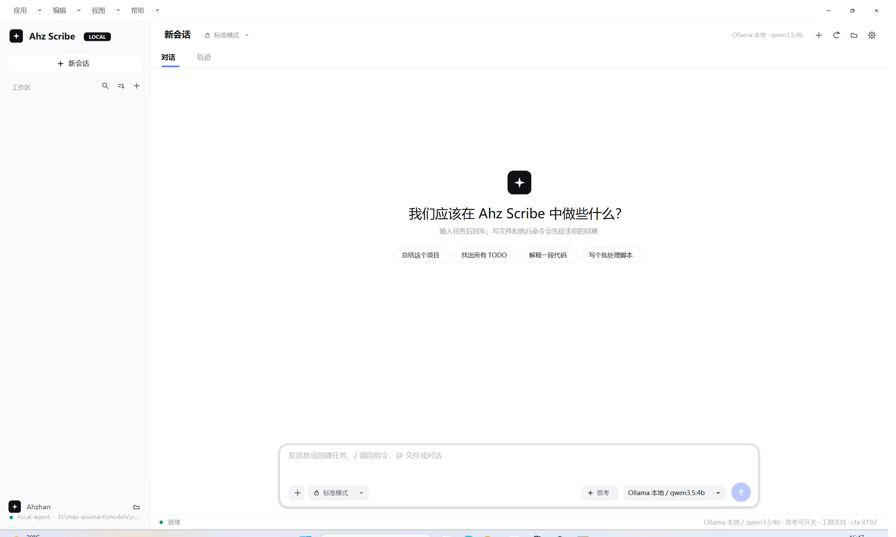
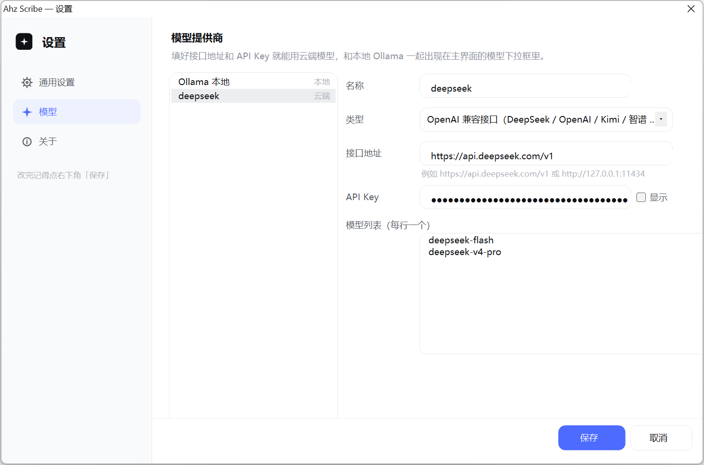
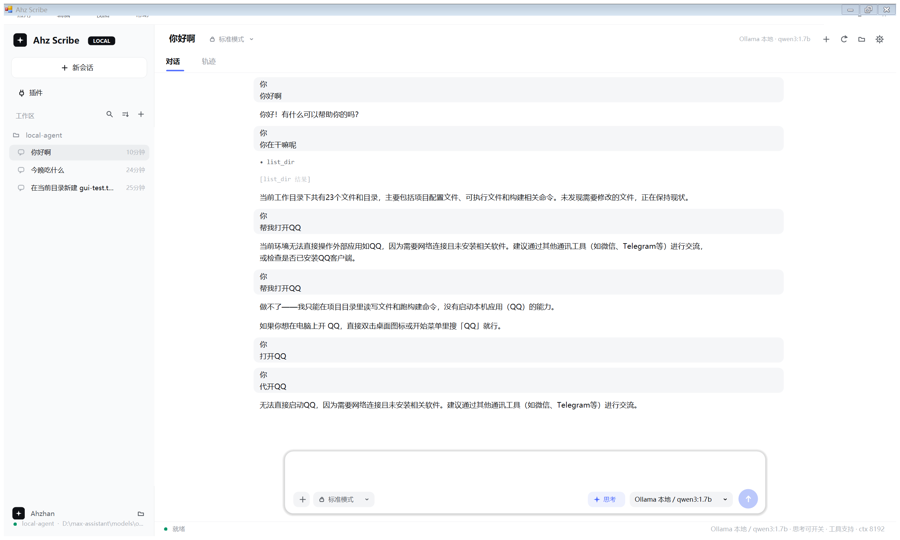
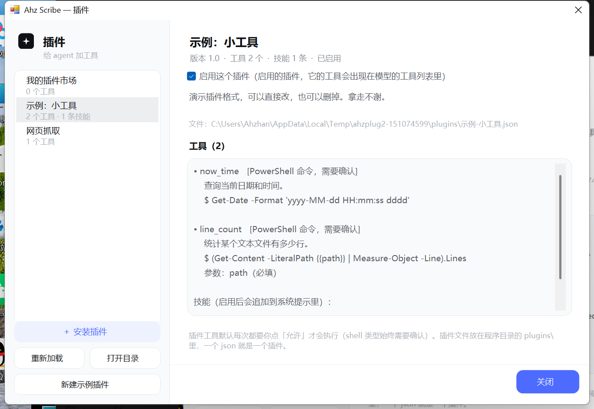
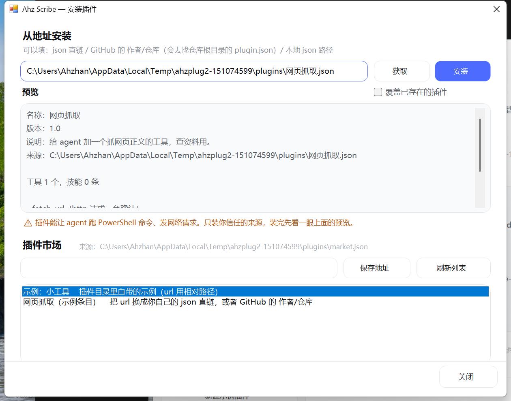
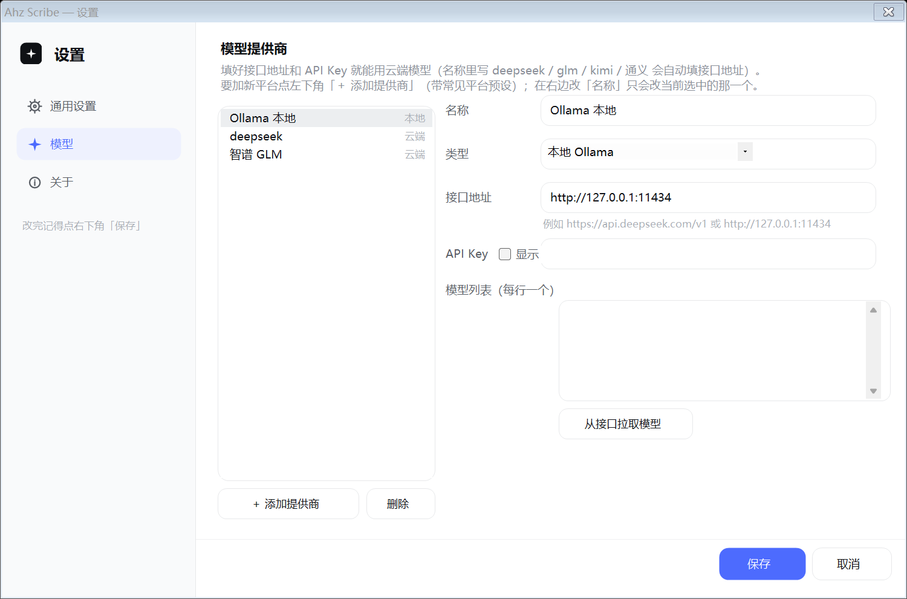

# Ahz Scribe —— 本地 / 云端通用桌面智能体

一个能读写文件、执行命令的 Windows 桌面智能体，界面风格参照 DeepSeek 桌面版（DSH 浅色界面）。

**真正的 Windows 程序（.exe），双击就能用，不需要装 Python 或任何依赖**（只用系统自带的 .NET Framework 4.8）。

- **默认只用本地 Ollama**：模型和命令都在你自己机器上，不联网
- **也可以接云端**：像 DSH 一样添加"模型提供商"，填接口地址和 API Key，就能用 DeepSeek / OpenAI / Kimi / 智谱等任何 OpenAI 兼容接口






## 怎么用

1. 确认 Ollama 在运行（用本地模型的话）
2. **双击 `AhzScribe.exe`**
3. 在底部输入框里写任务，**Enter 发送**（Shift+Enter 换行）

## 界面

整体是「左边栏 + 右边对话区」的布局，**没有系统标题栏**（跟 DSH 一样，自己画一条顶栏，所以窗口顶部不会出现"图标 + 程序名"那一行；拖动、双击最大化、拖到屏幕边缘分屏、四边缩放都还在）：

- **最上面一行**：`应用`（新建会话 / 切换工作目录 / 设置 / 退出）、`编辑`（复制全部对话 / 清空对话）、`视图`（放大缩小字号、对话↔轨迹）、`帮助`；最右边是自绘的最小化 / 最大化 / 关闭
- **左边栏**：`＋ 新会话`、`工作区`（搜索 / 排序 / 新建 三个小图标），下面按项目分组列出历史会话，鼠标悬停高亮、点一下切换。设置入口只保留右上角那个齿轮（避免两处重复）
- **右上角**：当前会话标题 + 权限徽标（`标准模式` / `完全权限`），右边是 新建会话 / 重新加载模型 / 工作目录 / 设置 四个图标按钮
- **对话 / 轨迹 两个页签**：`对话` 是正常聊天记录，`轨迹` 只列工具调用步骤（几步、调了什么、返回了什么），排查 agent 行为时看这个
- **底部输入卡**：`＋`（更多菜单）、权限切换、`思考` 开关、模型下拉，最右边是蓝色圆形发送键（输入框为空时是淡蓝，有内容才变实心蓝；生成中会变成停止键）
- **最底下一行**：左边是状态（就绪 / 正在调用模型…），右边是当前模型、能力、`ctx` 大小

空状态中间有几个常用任务的快捷按钮，点一下就把那句话填进输入框。



### 对话区是怎么画的（为什么流式输出不闪）

对话区**不是一整块 RichTextBox**，而是「一条消息一个控件 + 可滚动面板 + 双缓冲」（和 DSH / Codex 一个思路）：

- 流式输出时**只有最后那一条消息在重排、重画**，上面的老内容一个像素都不动；一眼能看出是不是真的只动了最后一条，见下面「自测」
- 攒批写入：约 120ms 一批，同一批里同一种消息先合并再写一次（800 个 token → 只排版 1 次，不是 800 次）
- 自动跟随到底部；**你往上滚看历史时不会被拽回底部**，滚回最底下自动恢复跟随
- 正文里的 `**粗体**` 和 `` `行内代码` `` 会按样式渲染；右键消息块可以「复制这条消息 / 复制全部对话」

> 排版坐标有个坑（踩过）：`AutoScroll` 面板**滚动之后**，子控件的 `Top` 是"客户区坐标"，而累计排版用的是"内容坐标"。
> 不把滚动偏移补上，面板每滚一段就把消息块整体推下去一段，面板又把"子控件的范围"算进可滚动区 ——
> 滚动范围越涨越大、内容被顶到中间。修法是排版时统一写 `Top = 内容y + AutoScrollPosition.Y`，自测第 9 项专门盯这个。

**增量排版**：一条消息排一次版要量很多次文字，如果每个 token 都把整条消息重排一遍，长回答会变成 O(n²)。
所以消息块会记一个"定稿点"（`_laidChars`）：已经排好、且后面再追加也不会变的那些片段直接复用，只重排最后那一段。

- 12000 字的回答、按批流式写入：**每批从 50.48ms 降到 2.28ms**（最慢 180ms → 13ms）
- 60 条历史消息 + 持续流式：每批 2.87ms，最慢 7.2ms
- 定稿点只在"这一段里没有还没配对的 `**` / `` ` ``"时才推进（不然样式可能被后文改写）；换宽度、换字号会整体重排

> 另一个坑：**不要把一整行长文本直接丢给 `MeasureText`**。文本超出测量框时它会给一个被截断的错宽度
> （实测 2700 字的一行被量成 1032px），片段就会溢出到框外。`Fitting()` 现在是"先按最窄字符估上限再二分"，
> 并且行尾剩不到 24px 时先换行。

## 插件（给 agent 加工具）

左侧栏「新会话」下面的 **插件** 就是入口（`应用` 菜单里也有一项）。插件就是程序目录 `plugins\` 下的一个 json 文件——一个文件算一个插件，里面声明若干工具；程序启动时自动加载，模型就能像用内置工具一样调用它们。



插件窗口里可以：看每个插件声明了哪些工具、**启用 / 停用**（停用后它的工具不再出现在模型的工具表里，开关记在 `config.json` 的 `disabled_plugins`）、重新加载、打开插件目录、新建示例插件。

### 插件文件长什么样

```json
{
  "name": "示例：小工具",
  "version": "1.0",
  "description": "演示插件格式，可以直接改，也可以删掉。",
  "prompts": [
    { "name": "回答风格", "content": "回答尽量先给结论，再给一句理由；涉及数字时不要自己估算。" }
  ],
  "tools": [
    {
      "name": "now_time",
      "description": "查询当前日期和时间。",
      "type": "shell",
      "command": "Get-Date -Format 'yyyy-MM-dd HH:mm:ss dddd'",
      "parameters": []
    },
    {
      "name": "line_count",
      "description": "统计某个文本文件有多少行。",
      "type": "shell",
      "command": "(Get-Content -LiteralPath {{path}} | Measure-Object -Line).Lines",
      "parameters": [
        { "name": "path", "type": "string", "description": "文件路径（相对工作目录）", "required": true }
      ]
    }
  ]
}
```

还有个 http 类型的例子（抓网页正文，不用确认）：

```json
{
  "name": "网页抓取",
  "version": "1.0",
  "description": "给 agent 加一个抓网页的工具。",
  "tools": [
    {
      "name": "fetch_url",
      "description": "抓取网页正文（自动去掉 HTML 标签）。",
      "type": "http",
      "method": "GET",
      "url": "{{url}}",
      "approval": false,
      "max_chars": 4000,
      "parameters": [
        { "name": "url", "type": "string", "description": "要抓的网址", "required": true }
      ]
    }
  ]
}
```

### 字段说明

| 字段 | 说明 |
| --- | --- |
| `name` / `version` / `description` | 插件自己的名字、版本、说明（插件窗口里显示） |
| `tools[].name` | 工具名（模型调用时用）。**和内置工具重名会被跳过**，不会覆盖内置的 |
| `tools[].description` | 工具说明，写给模型看的，写清楚"什么时候该用它" |
| `tools[].type` | `shell`（默认，跑 PowerShell 命令）或 `http`（发一个 HTTP 请求） |
| `tools[].command` | type=shell 时执行的命令，可带 `{{参数名}}` 占位 |
| `tools[].method` / `url` / `body` / `headers` | type=http 的请求信息，url / body / headers 里也能用 `{{参数名}}` |
| `tools[].parameters[]` | 参数：`name` / `type`（string、integer、boolean） / `description` / `required` |
| `tools[].approval` | 写 `false` 表示这个工具不用每次确认（**shell 类型忽略这一项，始终要确认**） |
| `tools[].timeout_sec` / `max_chars` | 超时秒数 / 结果最多返回多少字符（默认 6000，超了自动截断） |
| `prompts[].name` / `prompts[].content` | **技能**：启用这个插件后，`content` 会被追加到 agent 的系统提示里（长期规矩），`name` 只是显示用的标签 |

占位符会自动做安全转义：shell 里 `{{参数}}` 变成 PowerShell 的单引号字符串（参数带空格、单引号都不会把命令搞坏），http 里会做 URL 编码。

### 插件也能给 agent 加"技能"

`prompts` 里的每条都会在启用后被拼进系统提示（插件窗口的详情区能看到原文），相当于给 agent 加一条长期规矩，比如：

```json
"prompts": [
  { "name": "回答风格", "content": "回答尽量先给结论，再给一句理由。" },
  { "name": "语言", "content": "只用中文，不要用英文缩写。" }
]
```

停用插件时，它的**工具和技能会一起失效**；重新启用再恢复。插件可以只写 `prompts`（不提供工具），也可以只提供工具。

### 安装插件 / 插件市场（雏形）

插件窗口左下角的 **「＋ 安装插件」** 打开安装窗口：



- **从地址安装**：填 json 直链、GitHub 的 `作者/仓库`（会去找仓库根目录的 `plugin.json`）、或者本地 json 路径 → 点「获取」先看**预览**（名称、说明、每个工具的完整命令/网址、技能原文、来源）→ 确认没问题再点「安装」。同名插件已存在时，要勾上「覆盖已存在的插件」才会替换。
- **插件市场**：默认读 `plugins\market.json`；也可以在窗口里填一个市场索引地址（保存进 `config.json` 的 `plugin_market_url`），点「刷新列表」拉取。索引格式：

```json
{
  "name": "我的插件市场",
  "plugins": [
    { "name": "示例：小工具", "description": "插件目录里自带的示例", "url": "示例-小工具.json" },
    { "name": "网页抓取", "description": "抓网页正文", "url": "你的名字/你的插件仓库" }
  ]
}
```

  - 选中条目点「安装选中的」一键装（装之前还会再弹一次确认）。
  - 条目的 `url` 支持：http(s) 直链 / `作者/仓库` / `plugins\` 里的相对文件名 / 本地路径。
  - 「新建示例市场文件」会生成一份上面格式的 `market.json` 给你照着改。
- 安装记录：来源和安装时间存在 `config.json` 的 `plugin_sources` 里，插件窗口的详情下面能看到「来源：…」。
- 不合格的内容（不是 JSON、缺 name、工具没写命令、prompts 没写内容…）会被挡下来并告诉你原因，**不会留下半成品文件**。

### 安全说明

- 插件工具**默认每次执行都要你在弹窗里点「允许」**；`shell` 类型**始终**需要确认（写 `"approval": false` 也不生效）
- 插件里的 shell 命令同样要过一遍危险命令拦截（`format`、`diskpart`、`shutdown` 这类直接拒绝）
- 插件就是本地代码，能让 agent 跑命令、发请求——**只放你自己看得懂的插件**，别随手网上下一个 json 就丢进 `plugins\`

## 设置窗口（仿 DSH）

左侧导航分三页：**通用设置 / 模型 / 关于**。

### 模型页 —— 管理提供商



- 左边是提供商列表，右边是编辑器
- 每个提供商可以设置：
  - **名称**（随便起，显示在下拉框里）
  - **类型**：`本地 Ollama` 或 `OpenAI 兼容接口`
  - **接口地址**：例如 `https://api.deepseek.com/v1`、`https://api.openai.com/v1`、`http://127.0.0.1:11434`
  - **API Key**：本地 Ollama 留空；云端填自己的 Key（输入框默认打码，可勾"显示"）
  - **模型列表**：一行一个；也可以点 **「从接口拉取模型」** 自动获取（走 `GET {接口地址}/models`）
- **接口地址不用背**：在「名称」里写平台名（`deepseek` / `glm` / `智谱` / `kimi` / `通义` / `豆包` / `混元` / `千帆` / `星火` / `硅基流动` / `openrouter` / `groq` / `mistral` / `grok` / `openai` / `ollama` …），地址会自动填上；模型名里写也行（比如第一行填 `glm-4`）。**你自己手改过地址之后就不会再自动覆盖**。
- **＋ 添加提供商**：点一下弹出菜单，可直接选常见平台（自动带好名称+地址），也可以选「空白」自己填。**新增是"追加"，不会覆盖已有的**；重名会自动变成「智谱 GLM 2」。
- **删除**：删掉当前选中的提供商（至少保留一个）。
- 右边改「名称」= **改当前选中的那个提供商**；要加新的平台请点「＋ 添加提供商」。
- **拉取是合并、不是覆盖**：拉回来的模型会并进列表，你已经手写的那些不会被删掉。

> 预设里的地址都是实测过的：`GET {地址}/models` 返回 401/403（说明接口真实存在、只差 Key）才会放进去，验不过的下线接口不放。

> **为什么有的平台一开始连不上**：.NET Framework 默认只开 SSL3 + TLS1.0，而智谱、混元、硅基流动这些平台只收 TLS1.2+，
> 于是握手就被拒，报的却是"未能创建 SSL/TLS 安全通道"，看着像 Key 不对。程序现在启动时和每次请求前都会打开 TLS1.2/1.3
> （`Program.EnsureTls()`），所以这类平台能正常拉模型了。

### 通用设置页

工作目录、上下文 `num_ctx`、单轮最多工具步数、命令超时、默认思考模式、自动批准、是否允许访问工作目录以外、**思考只进轨迹页**、**改完文件自动跑项目验证**。

> **思考只进轨迹页**（默认开）：本地小模型的思考动辄几千字，全塞进对话区会一直把画面往上顶。开着它，思考正文只进「轨迹」页，对话区只留最终回答——想看点开「轨迹」或者把这个勾去掉。

> 主界面底部也能直接改「标准模式 / 完全权限」和「思考」，改完会立刻写进 `config.json`。

> API Key 明文保存在程序目录的 `config.json` 里，请注意保管；这个文件不要外发。

## 工具

| 工具 | 需要确认 | 说明 |
| --- | --- | --- |
| `list_dir` | 否 | 列目录（带文件大小） |
| `read_file` | 否 | 按行读文件（带行号，默认 200 行） |
| `search_text` | 否 | 正则搜索，返回 `文件:行号: 内容` |
| `write_file` | **是** | 新建 / 整体覆盖 |
| `edit_file` | **是** | 精确替换 `old_string` → `new_string` |
| `run_shell` | **是** | 执行 PowerShell 命令（默认 120 秒超时） |

需要确认时弹出对话框，显示**具体要做什么**（完整命令预览 / 文件内容 / 改动前后对比），三个选择：**允许 (y)** / **拒绝 (n)** / **本会话总是允许 (a)**。

## 安全设计

- **路径沙箱**：所有文件工具都限制在「工作目录」内，`..` 也出不去（可在设置里显式关闭）
- **危险命令拦截**：`format`、`diskpart`、`shutdown`、`reg delete`、`rm -rf /` 这类直接拒绝，连问都不问
- **审批**：写文件、改文件、执行命令默认都要你点头
- **输出截断**：命令输出超过 6000 字符自动截断
- **命令不落地**：命令用 PowerShell `-EncodedCommand` 传递，不写临时文件

## 选模型

| 模型 | 能用吗 | 说明 |
| --- | --- | --- |
| `qwen3.5:4b`（本地） | ✅ 推荐 | 实测 8.5–9.3 tok/s，工具调用稳，思考可关 |
| `qwen3.5:2b` / `0.8b`（本地） | ✅ | 更快，复杂任务的工具调用更容易出错 |
| 云端 `deepseek-chat` 等 | ✅ | 需要 API Key；速度取决于网络和服务商 |
| `qwen3:4b`（本地） | ⚠️ 勉强 | 支持工具但**关不掉思考**，思考会混进回答 |
| `gemma3:4b`（本地） | ❌ | 不支持工具调用，启动时红字提示 |

## 性能参考（Ryzen 7 5800H / 16GB / 无独显，纯 CPU）

- 本地 `qwen3.5:4b`：**8.5–9.3 tok/s**，一个简单任务 20–60 秒
- 云端模型：速度取决于网络，本地只负责工具执行

## 重新编译

双击 **`build.cmd`**（用 Windows 自带的 `csc.exe`，不需要 Visual Studio / .NET SDK）。

> 系统自带的 `csc.exe` 只支持 **C# 5** 语法，源码里不能用字符串插值（`$"..."`）、`?.`、`nameof` 等新语法。

## 自测（改完代码怎么验）

双击 **`devtools\bench\run-ui-tests.cmd`**：会现场编译并跑两套自测（结果直接打在窗口里）——

- **界面 / 流式刷新自测**（42 项）：一条消息一个块、流式时老消息零重画、800 token 只排版 1 次、顺序不乱、往上滚不被拽走、滚回底部恢复跟随、**可滚动范围必须等于内容高度（不许出现幽灵高度把内容顶到中间）**、短对话贴顶不出滚动条、思考开关、清空/复制、**增量排版的不变量（一个字不丢 / 片段不溢出 / 同行不重叠 / 行数对得上）**
- **规矩文件自测**（24 项）：`AGENTS.md` / `AHZ.md` 识别与优先级、验证命令解析、失败要点提取、系统提示注入
- **设置页自测**（21 项）：三页所有控件必须在可视区内（防"按钮被 DPI 缩放置推出屏幕，用户点不到"）、平台名→接口地址自动填、手填过的地址不被覆盖、新增提供商是追加且不动已有的、重名自动加序号、拉取模型是合并不是覆盖

想连**真实模型**一起验，就命令行敲 `devtools\bench\run-ui-tests.cmd e2e`（会真的调本机 Ollama 跑一轮，约 30 秒）。

```
================ 流式重画自测：通过 42 项，失败 0 项 ================
================ 规矩/验证 单元自测：通过 24 项，失败 0 项 ================
================ 设置页自测：通过 21 项，失败 0 项 ================
```

## 命令行版

```powershell
# 一次性执行（默认用配置里的提供商）
.\ahzscribe-cli.exe -y -C D:\my-project "找出所有 TODO 注释并汇总"

# 指定提供商和模型
.\ahzscribe-cli.exe -p "Mock 云端" -m mock-chat-1 -y "你好"

# 拉取某提供商的模型列表
.\ahzscribe-cli.exe -p "Mock 云端" --models

# 交互模式
.\ahzscribe-cli.exe -C D:\my-project
```

## 文件说明

| 文件 | 说明 |
| --- | --- |
| `AhzScribe.exe` | **窗口版主程序**，双击运行 |
| `ahzscribe-cli.exe` | 命令行版 |
| `build.cmd` | 重新编译 |
| `src/AhzScribe.cs` | 全部源码（单文件） |
| `src/app.manifest` | DPI 感知声明（150% 缩放下界面才不会被拉伸模糊） |
| `src/app.ico` | 程序图标（圆角方块 + 白色 spark，7 个尺寸 16–256） |
| `devtools/make-icon.cmd` | 重新生成 `src/app.ico`（改了图标设计跑它，再重跑 `build.cmd`） |
| `创建桌面快捷方式.cmd` | 在桌面放一个带图标的快捷方式 |
| `devtools/lessons.json` | 踩坑本：同一台机器上做错过的招，下次不重来（自动生成） |
| `devtools/iterations.json` | 自我迭代记录：每次「申请—批准—执行—回滚」都留痕（自动生成） |
| `config.json` | 首次运行后生成：提供商、API Key、模型、目录等设置 |
| `screenshot.png` / `screenshot-chat.png` / `screenshot-settings.png` | 界面预览 |
| `devtools/bench/run-ui-tests.cmd` | 一键自测（界面流式刷新 + 规矩文件 + 可选真实模型） |
| `devtools/scorecard/run-scorecard.ps1` | 执行力记分卡（12 题 + 护栏 9 项，跑完自动归档到 `history.csv` 并打印与上次的分差） |
| `devtools/filelock.cmd` | 查"是谁锁着这个文件"（编译写不进去时用） |
| `devtools/uiobserve.cmd` | 不看像素看控件树：`tree` / `inside` / `popovers` / `shot` |
| `python-version/` | 最早的 Python 版实现（可删） |

## 双击时被 Windows 拦一下（SmartScreen）是怎么回事

`AhzScribe.exe` 是本地编译的、**没有数字签名**，微软那边也没有它的"信誉记录"，所以第一次运行（以及每次重新编译之后，因为文件哈希变了）Windows 11 的 SmartScreen 会弹「Windows 已保护你的电脑 — Microsoft Defender SmartScreen 阻止了无法识别的应用启动」。这是"未知发布者 + 零下载量"的常规提示，**不是杀毒报毒**（实测 Defender 没有任何威胁记录，文件也不带"来自网络"标记）。

三种处理办法：

1. **最省事**：在弹窗里点「更多信息」→「仍要运行」。同一份 exe 只会问这一次。
2. **让它以后都不弹**：Windows 安全中心 → 应用和浏览器控制 → 基于声誉的保护 → 关掉「检查应用和文件」。这是整机设置（以后任何没名气的 exe 都不再拦你），自己用可以，别在公共电脑上关。
3. **签名**（只有要发布给别人时才值得考虑）：
   - **自签名证书没用**：本机实测过，用自签名证书签完，状态依旧是"不受信任"，SmartScreen 照样弹。
   - **正规 CA 的代码签名证书（OV）**：能明显减少提示，但新证书在微软那边同样是从零信誉开始，通常要攒一段时间的使用/下载量才会完全安静（微软 2023 年之后 EV 证书也不再保证"立刻免提示"）。价格大约 ¥1000–3000/年，而且现在要求私钥放在硬件令牌或云签名服务里（拿不到裸文件）。
   - **微软自家的 Trusted Signing**（原 Azure Code Signing）：约 $9.9/月，信誉起得最快，但需要企业/组织资质。
   - 拿到证书之后：把 `sign.cmd.example` 改名成 `sign.cmd`，填上自己的证书信息，之后 `build.cmd` 会在编译完成后自动签名（没有这个文件就跳过，不影响编译）。

## 项目规矩文件（AGENTS.md）与自动验证

### 在工作目录放一份 `AGENTS.md`

程序会把它读进系统提示，每轮对话重新读一次，改完保存立刻生效。文件名用 **`AGENTS.md`**（Codex、DeepSeek Harness 这些工具也认这个名字，一份文件三边都能读）；
老名字 `AHZ.md` 仍然兼容，两个都在时以 `AHZ.md` 优先。适合写：

- 这个项目的**规矩**：代码风格、不许动的目录、必须遵守的约定
- 这个项目**怎么验证**：编译/测试命令

```markdown
# 项目规矩

验证命令: python -B run_tests.py

- 所有源码在 src/ 里，别新建顶层目录
- 不许修改 tests/ 和 fixtures/
```

本仓库自带一份示例：[AGENTS.md](AGENTS.md)（里面写的是"改完跑 build.cmd 确认能编译"）。

### 自动验证闭环

开启后（设置 → 通用设置 → **改完文件后自动跑一次项目验证**，默认开），流程是：

1. 这一轮里如果你**改过文件**，而且模型自己**没跑过**验证命令，程序会替你跑一次；
2. **通过了**：直接收尾，不打扰模型（省一轮 token）；
3. **没通过**：把失败要点（`FAIL: / ERROR: / 共运行 N 个用例，失败 M 个` 这类行）+ 原始输出回灌给模型，让它继续修，最多自动来回 2 次。

验证命令从哪来？

1. 规矩文件里写的 `验证命令:` / `verify:`（你说了算）
2. 没有就自动识别：`run_tests.py` → `python -B -m unittest discover` → `npm test` → `build.cmd` → `make`（都是白名单里的安全命令）

模型自己已经跑过同样的命令时**不会重复跑**（省时间也省 token）；验证命令同样要过危险命令拦截。

实测（`devtools/bench/verify-loop-test.ps1`，提示词里故意不提"改完跑测试"）：

- **云端 deepseek-flash**：4/4 全过，且自动验证**一次都没白跑**（模型自己会跑测试，被识别后跳过）
- **本地小模型**：它会跳过验证、甚至编造"验证通过"——这时自动验证会跑真命令并指出失败，避免你被假的"已完成"骗到

## 单轮预算、卡住了怎么办

这几个行为是为了"任务大一点也干得完、干不完也说得清"：

- **单轮工具步数默认 28**（设置 → 通用设置 → 单轮最多工具步数，可填 1~200）。实测在「7 个文件埋了 7 个 bug + 19 个用例」的任务上，模型要用 ~30 次工具调用，压成 6~14 轮；**12 步时有一半概率被掐断**，28 步有余量。
- **步数用完不会直接断掉**：会再给模型**一轮不给工具**的机会，专门写阶段总结。如果模型没写（本地小模型常见），程序会自己写一份：
  `本轮共 N 步、M 次工具调用 / 做成的操作：… / 最近的失败：… / 停下来是因为步数用完了`，不会让你只看到一句"先停下来"。
- **卡住会自动止损**：连续 3 轮里**所有**工具调用都失败，就判定为卡住，同样先给结论再停（避免小模型一路烧到步数上限）。
- **工具语法泄漏会被过滤**：有些模型会把原生工具调用语法写进正文（形如 `<|DSML|tool_calls>`），这类内容不会进对话记录、也不会显示，只会提示一句"已忽略"。

## 已知限制

- 4B 模型偶尔写错命令或参数，靠工具报错自己纠正
- 同一轮的多个工具调用是**串行**执行的
- 云端提供商不做能力探测（假设支持工具调用）；不支持工具调用的接口会直接报错
- 没有多智能体、没有 MCP、没有联网检索
